<p align="center">
  
</p>

<p align="center">
  
  
  
  
  
</p>

<p align="center">
  
  
  
</p>

<p align="center">
  <a href="https://github.com/lxnte/atlas-launcher/releases/latest">
    
  </a>
</p>

<p align="center">
  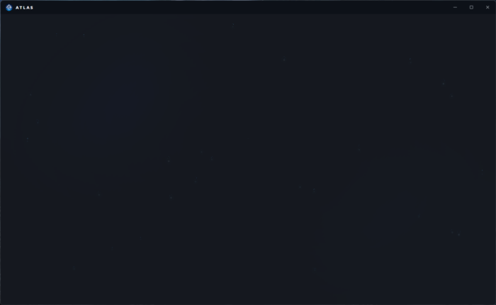
</p>

### About

Atlas is a game library for Windows. Every game you own — your whole Steam account, games from anywhere else, cracked or not — in one fast, clean, Steam-style library.

- **Your Steam library, read locally.** Every game on your account, installed or not, with your real Steam hours and the official artwork, straight from the Steam client's files. No login, no API key.
- **Any other game too.** Point Atlas at an `.exe`, pick the game from the official Steam catalogue, and it gets the real name, cover, banner and logo.
- **Steam, but lighter.** Steam's interface is a whole web browser using hundreds of MB. Atlas puts it to sleep while you play — and tunes Steam's settings in one click — so your games get more of your PC.
- **Launch options without opening Steam.** Explained options and good presets (Counter-Strike 2 included), set to your monitor's refresh rate automatically.
- **Hours for everything.** Steam games use Steam's own hours; for every other game a ~1 MB helper counts your play time and exits with the game (you can turn it off).
- **It finds things on its own.** Steam on any drive, library folders on any disk, and games you moved to another drive are found again automatically.
- **Keeps itself up to date.** New versions are signed and install themselves in one click — or turn automatic updates off and check whenever you like.

### Screens

<table>
  <tr>
    <td width="50%">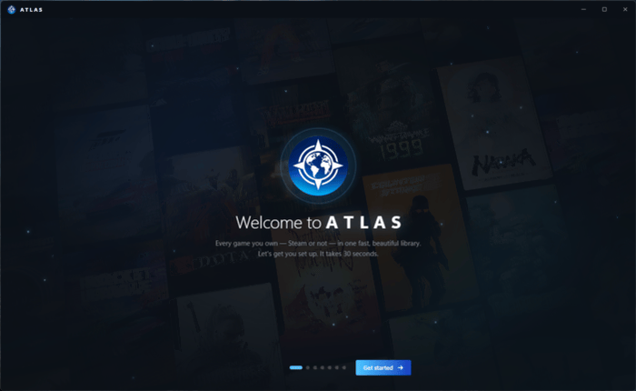<br><sub><b>Set up your profile</b> — name, avatar and background, with a live preview.</sub></td>
    <td width="50%">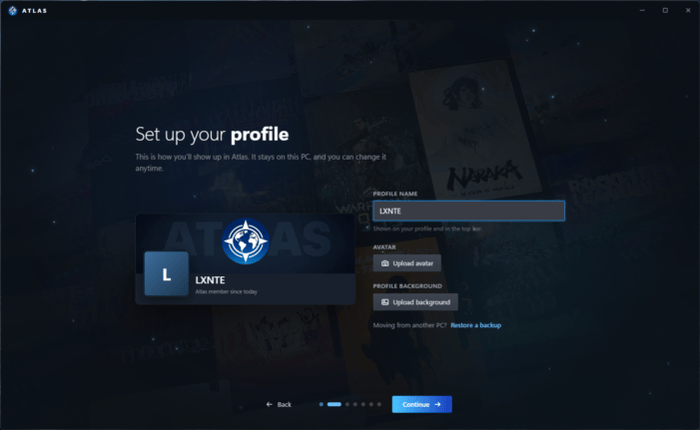<br><sub><b>Pick your look</b> — 8 themes that tint the whole app, plus OLED black.</sub></td>
  </tr>
  <tr>
    <td width="50%">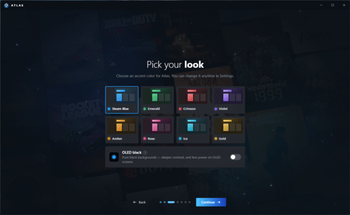<br><sub><b>Your Steam library</b> — found and counted automatically.</sub></td>
    <td width="50%">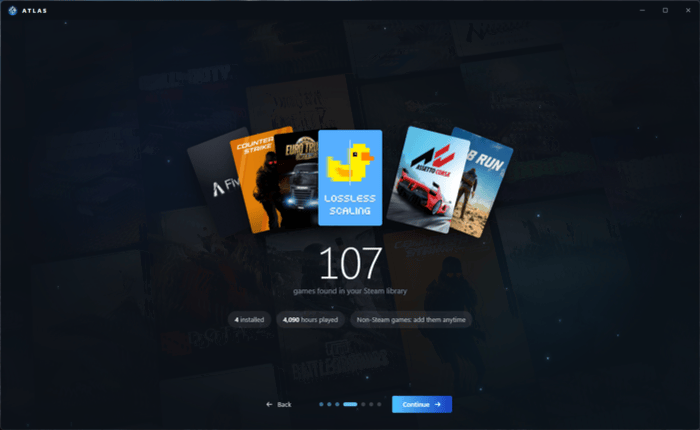<br><sub><b>When you play</b> — close or minimize Atlas, so your game gets the whole PC.</sub></td>
  </tr>
  <tr>
    <td width="50%">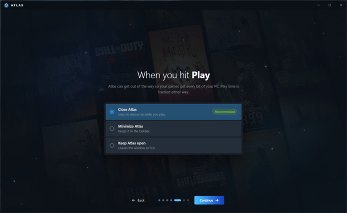<br><sub><b>Make Steam lighter</b> — optimize Steam right from the setup.</sub></td>
    <td width="50%">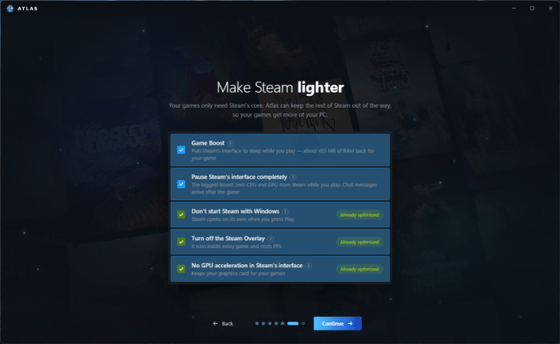<br><sub><b>All set</b> — your games fill the circle.</sub></td>
  </tr>
  <tr>
    <td width="50%">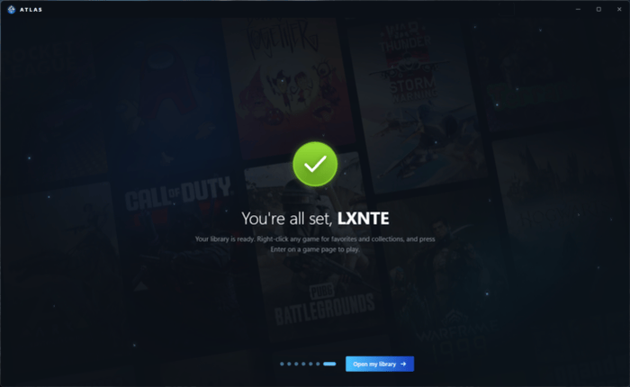<br><sub><b>The library</b> — recent games, collections and every game you own.</sub></td>
    <td width="50%">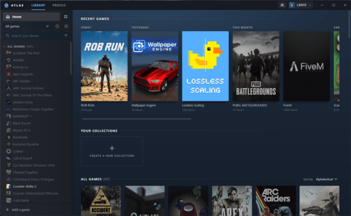<br><sub><b>Your profile</b> — total hours, most played and recent activity.</sub></td>
  </tr>
  <tr>
    <td width="50%">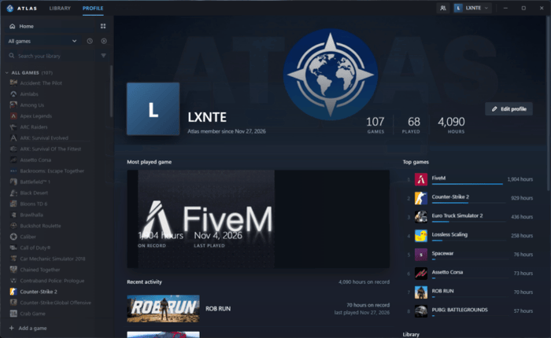<br><sub><b>Optimize Steam</b> — see what's active, turn anything on or off.</sub></td>
    <td width="50%">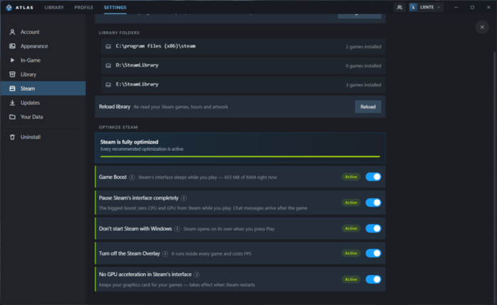<br><sub><b>Launch options</b> — presets and explained options, tuned to your monitor.</sub></td>
  </tr>
</table>
### Features

| Area | What you get |
| --- | --- |
| Library | Steam + non-Steam games in one list, favorites, your own collections, hide games, search, sort by name, hours, last played, date added or size |
| Game page | Steam-accurate hero banner and logo placement, Play / Install, size on disk, first and last played, longest session, notes, latest news and patch notes |
| Non-Steam games | Add any `.exe`, scan a whole folder, match with the official Steam catalogue for name and artwork, launch options |
| Steam optimizer | Game Boost (Steam's interface sleeps while you play, ~600 MB of RAM back), full pause of Steam's interface, no start with Windows, no overlay, no GPU-accelerated interface — every change reversible |
| Launch options | Steam games launch with your own options through Steam; presets and explained options, `-refresh` set to your monitor automatically |
| Play time | Steam hours from Steam; every other game tracked by Atlas, even while Atlas is closed — can be turned off |
| Profile | Local profile with avatar and background, total hours, most played, recent activity — kept even for games you removed |
| Discord | Rich Presence: "Playing Atlas" while you browse, and the game you launched while you play |
| Updates | Signed auto-updates you can turn off, Check for Updates with version and release date, download progress, restarts on its own |
| Maintenance | Steam auto-detected on any drive, moved games re-found automatically, uninstall from Settings |

### Install

1. Download **Atlas Setup** from the [latest release](https://github.com/lxnte/atlas-launcher/releases/latest).
2. Run it — no admin rights needed, it installs for your Windows user only.
3. Atlas opens with a short setup. Your Steam games are already there.

> The installer isn't code-signed yet, so Windows SmartScreen may show "Windows protected your PC". Click **More info → Run anyway**.

### Build from source

| Need | Version |
| --- | --- |
| Rust | stable (MSVC toolchain) |
| Visual Studio Build Tools | C++ workload |
| Tauri CLI | `cargo install tauri-cli --version "^2"` |

```powershell
cd atlas/src-tauri
cargo tauri build
```

The installer is written to `atlas/src-tauri/target/release/bundle/nsis/`.

### How it's built

| Part | Tools |
| --- | --- |
| App | Rust, Tauri 2, WebView2 — a 2.4 MB installer, ~30 MB of RAM |
| Steam | Parses `libraryfolders.vdf`, app manifests, `localconfig.vdf` (hours) and the binary `appinfo.vdf` (names, icons, logo placement) |
| Interface | Plain HTML, CSS and JavaScript — no framework, no bundler |
| Play time | A detached `atlas.exe --track` helper that follows the game's process tree |
| Discord | Rich Presence over Discord's local IPC pipe, no extra libraries |
| Optimizer | Process priority, working-set trimming and suspend/resume of `steamwebhelper` while `RunningAppID` says a game is running |
| Updates | Tauri updater with signed releases from GitHub |

### Privacy

Everything Atlas knows about you — profile, play time, notes, collections — stays in `%APPDATA%\Atlas` on your PC. The only things it fetches from the internet are public: game artwork and news from Steam's CDN and store, and update checks from this repository.

<p align="center"><sub>Romania · Atlas · built with Rust</sub></p>
